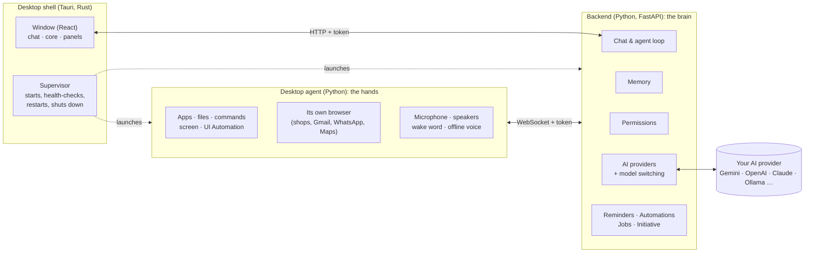

# JARVIS

**A personal AI assistant that lives on your Windows PC, modelled on JARVIS from the Iron Man films.**

It talks and listens, remembers you across conversations, and actually does things on your computer: opens apps,
runs commands, edits files, reads your screen and clicks for you, researches the web, reads your documents, plays
your music, finds places on Google Maps, and runs jobs on a schedule.
You decide how much it may do, action by action.

**Bring your own AI.** JARVIS ships with no keys and no account; it works with the
[AI providers listed below](#supported-ai-providers).

> **Status:** early and moving fast. Windows 10/11 only, run from source (no installer yet: see [Install and run](#install-and-run)). Everything listed below
> works today; see [Roadmap](#roadmap) for what's next and [How you can help](#how-you-can-help) for what we'd love
> from you.

**[Documentation](docs/index.md)** · **Stack:** Tauri 2 (Rust) · React + TypeScript · Python 3.12 (FastAPI backend + desktop agent) · MIT licensed

---

## Contents

- [What JARVIS can do](#what-jarvis-can-do)
- [How it works](#how-it-works)
- [Safety, permissions and privacy](#safety-permissions-and-privacy)
- [Supported AI providers](#supported-ai-providers)
- [Install and run](#install-and-run)
- [Using JARVIS](#using-jarvis)
- [Project layout](#project-layout)
- [Tests](#tests)
- [Roadmap](#roadmap)
- [How you can help](#how-you-can-help)
- [Acknowledgements](#acknowledgements) · [License](#license)

---

## What JARVIS can do

### Talk to it
- **Chat** in a floating window over an animated core that reacts to what JARVIS is doing (idle, listening,
  thinking, speaking).
- **Live voice** (speech-to-speech with Gemini Live): say "Jarvis, …", it answers in its own voice and can use all
  its tools while talking. Say "Hey JARVIS" while it speaks to cut in. Spoken captions follow the voice sentence by
  sentence.
- **Offline voice** when there's no Gemini key or the connection is too slow: openWakeWord for the wake word,
  NVIDIA Parakeet or Whisper for speech recognition, Piper for speech, all running on your PC.
- **Answers only you**, if you want: teach it your voice once and other people saying "Jarvis" are ignored
  (speaker verification, offline).
- **Start-up briefing**: when it opens, JARVIS tells you how the PC is doing, what's running, and what's due today.
- **Initiative**: welcomes you back after you've been away, and follows up on a conversation left hanging (at
  most 3 times an hour, and only with a reason). Both can be turned off.
- **Heartbeat**: every so often (30 minutes by default) JARVIS goes through a short list you write ("anything
  urgent in my mail?", "a meeting in the next 30 minutes?", "a drive over 90% full?") and speaks up only when one
  needs you. It only looks, never changes anything, stays quiet during quiet hours and while you're away, and
  doesn't repeat itself.
- **English or Hindi**: the interface, JARVIS's replies and the offline voice (Settings → General → Language).

### Act on your PC
- **Apps and windows:** open, close, switch, arrange, wait for windows; find and press buttons by their real text
  (Windows UI Automation), falling back to Windows' built-in OCR when an app exposes nothing.
- **Screen:** look at the screen, read a window, click, drag, scroll and type anywhere.
- **Like a developer at a terminal:** run PowerShell or cmd (git, python, npm, winget…), read, write and edit
  files with automatic backups, list and end processes, start long jobs in the background.
- **Files:** find, open, copy, move, organise folders (with a dry-run plan first), delete to the Recycle Bin.
- **System:** health (CPU, memory, disk, battery, graphics card, temperatures), volume, media keys, brightness,
  lock, sleep, restart, Windows settings pages, start with Windows.
- **Reminders, alarms and timers**, spoken at the right time; ones missed while the PC was off are mentioned once.
- **Calendar**, with no API key or sign-in of JARVIS's own: "what's on tomorrow?", "find me a free hour on
  Friday", "add the dentist on the 12th at 4 and remind me 30 minutes before". It reads JARVIS's own calendar,
  Google and Outlook.com calendars linked by their private address, and classic Outlook on your PC. It adds to
  JARVIS's calendar or Outlook directly, or opens Google's or Outlook's new-event page filled in for you to save.
- **Music:** "play Alfaaz on Spotify" searches Spotify, picks the right song and checks it's actually playing.

### Reads your other apps
- **Built in, and read-only:** news feeds, Hacker News and Obsidian work from the start. Add email (any IMAP
  provider), GitHub notifications, Granola and Oura with a token, and Google Drive, Contacts and Tasks, Dropbox and
  Strava by signing in with your own free app. Nothing here can send, change or delete anything.
- **One search across everything:** memories, past conversations, the calendar, stored documents and every connected
  app. If one app fails, the rest still answer.

### Works by itself over time
- **Always-running agents:** give JARVIS a goal ("tell me when this laptop drops under 60,000") and it keeps working on
  it over days or weeks, carrying on from its own notebook and speaking only when it has something to say.
- **Workflows:** lay a job out as steps with yes-or-no branches and loops, for when the order matters.
- **Coding jobs:** hand a job in a project folder to Claude Code, OpenCode or OpenHands, if installed, and get the report.
- **Other agents:** ask any agent that speaks the open A2A protocol.

### Work with the web
- **Deep research:** several rounds across the web, your documents and connected apps, ending in an answer with
  numbered sources. Private details never go into the web searches.
- **Research with sources:** its own web search (no AI service involved), news headlines with dates, and the
  passages from each page that answer the question, quoted with their links.
- **A browser JARVIS drives** (its own Brave, Chrome or Edge window, with its own profile): shop and fill carts, order food, compare
  products. **Paying always stays with you**: pay/place-order buttons and password, card, OTP and UPI fields are
  refused in code.
- **Gmail and WhatsApp, read-only:** "anything important in my mail?", "what did Mom say on WhatsApp?". You sign
  in once in JARVIS's browser window; JARVIS never types passwords and never sends, deletes or replies there.
- **Google Maps:** places near you with ratings and reviews, directions and travel times, using your PC's real
  location (with your permission).
- **About 2,200 public APIs** (weather, crypto, sports, news, holidays…) from the public-apis list, most needing
  no key.
- **Downloads** it makes, and notices finished downloads you start yourself.

### Documents, on your PC
- Reads **PDF, Word, Excel, PowerPoint, text and images** (Windows OCR) and answers from the exact passages, with
  page, slide or sheet.
- Keeps files in its own **file store** so later questions about them are instant.
- **Creates** Word, Excel, PowerPoint and PDF files.
- **Sandboxed Python** for analysing data someone else made: no network, no programs, no files outside its own
  folder.
- None of the reading or making involves an AI service; only the answer does.

### Remembers you
- **Long-term memory:** durable facts about you (name, preferences, goals, projects, people, how you like
  answers) are picked out after each message, updated when they change, and forgotten when you ask. Small talk is
  ignored.
- **The Memory panel** shows everything it knows: edit, delete (the whole history of a fact goes with it), export
  and import.
- **Long conversations** are summarised as they go, so the beginning isn't forgotten.
- **Encrypted backup and sync**: back up settings, instructions, memories, skills, automations, the calendar and
  plugins to one file locked with your passphrase (AES-256), and restore it on another PC. Or sync your PCs
  through a folder your OneDrive, Google Drive or Dropbox already syncs: no server, no account. Keys and tokens
  are included only if you choose.

### Learns and follows your way of doing things
- **Customize** is one place to shape JARVIS:
  - **Instructions**: how it should behave, in your own words ("keep it short", "reply in Hinglish", "my work
    folder is D:\Projects"). Read before every chat and voice conversation.
  - **Your skills**: named step-by-step recipes ("Morning setup: open Outlook and VS Code, play my focus
    playlist…"), used when you name them or your request matches.
  - **Learned workflows**: multi-step jobs that worked are remembered and reused as a guide next time; ones that
    keep failing are dropped.
  - **Automations**: jobs it does by itself on a schedule ("every weekday at 9, go through my unread mail and tell
    me what needs a reply"), with the result spoken aloud if you like. You can also just ask for one in chat.
  - **Heartbeat**: the list JARVIS checks every so often, how often, and quiet hours.
  - **Calendar**: what's coming up, new events, and linking Google or Outlook.com calendars.
  - **Agents** and **Workflows**: see above. Workflows have a step-by-step builder.
  - **Apps**: connect apps, and search everything.
  - **Plugins**: bundles of skills and connectors other people shared. Install one from the community catalog or
    a file, after seeing exactly what it adds (connectors arrive turned off). Share your own skills as a plugin.
  - **Connectors**: any MCP server (Slack, Notion, GitHub, calendars, databases…) becomes JARVIS tools.
  - **API keys** for public APIs that need one.

### Handles long jobs well
- **Task mode:** a longer job shows its plan and progress; you can pause, take over the mouse and hand back, or
  stop at any step. A job cut short by a restart is offered once, never resumed on its own.
- **An advisor model** reviews long tasks every few steps and after failures.
- **Emergency stop** stops everything at once.

### Gets the most out of any AI
- Prompt caching, token counting, tool search (only the relevant tools are sent each time), conversation
  compaction, and thinking/effort chosen per job, on Gemini, Claude and OpenAI-style providers alike.
- **Automatic model switching:** if a model is rate-limited, over quota or overloaded, JARVIS moves to another one
  and says so. It keeps its own count of each model's daily quota and learns the real limits.
- **A local AI gateway** (OmniRoute) can be started for you with one click, and used as a backup.

---

## How it works

JARVIS is four cooperating programs on your PC:



- **The shell** (`src-tauri/`) is the app you open. It starts the backend and agent hidden, checks they're healthy,
  restarts them if they crash, and closes everything cleanly when you quit.
- **The backend** (`backend/`) is the brain. It holds your settings (encrypted), memory, conversations, reminders,
  automations and permissions, talks to your chosen AI, and runs the agent loop: the AI proposes a tool call, the
  backend checks your permissions, asks you if needed, runs it, and hands back the real result. It only listens
  on `127.0.0.1` and every request needs a random token created at each start.
- **The agent** (`agent/`) is the hands. It does what the backend asks on Windows: apps, files, commands, screen,
  clicks and typing, its own browser, the microphone and speakers.
- **The window** (`src/`) is the React UI: chat, the animated core, and panels for conversations, memory,
  Customize, settings and system details.

### What happens when you ask for something

1. **You ask**, by typing or speaking, or an automation fires.
2. **The backend gathers context:** the memories relevant to your message, your instructions, any of your skills
   or learned workflows that match, the time, the PC's state, recent files, and the tools that fit the request.
3. **The AI answers or calls a tool.** Each tool call goes through the **permission check** (allow, ask, or
   block), then runs. Results go back to the AI, with any saved key or token scrubbed out first.
4. **This repeats** until the job is done. Long jobs become a visible task you can pause or take over. Guards stop
   repeated identical steps and endless searching, and a watchdog stops a run that stalls.
5. **The reply** streams to the window (and is spoken, if you used your voice or the briefing is on). Afterwards,
   new facts about you are saved to memory and a successful multi-step job may become a learned workflow.

### Memory, in short

Each message is embedded and searched against what JARVIS knows; the best matches go into the prompt. After the
reply, a small model extracts durable facts as create, update or delete operations. Changed facts keep their
history (so changes are auditable) until they're purged, and deleting a fact removes all of it. Upkeep and
summaries run as background jobs while you're away from the PC. Providers without embeddings (Claude) use keyword
search instead.

### Voice, in short

- **Live mode:** the agent streams your microphone to the backend, which relays it to a Gemini Live session; the
  spoken reply streams back to your speakers, with captions in step with each sentence.
- **Offline mode:** wake word → speech recognition (Parakeet or Whisper) → the normal chat pipeline → Piper speech.
- If the connection is too slow for live voice, JARVIS switches to offline voice for a while on its own.

---

## Safety, permissions and privacy

JARVIS can do a lot on your PC, so control is built in, not bolted on.

**Permissions** (Settings → PC control & safety) set **Allow, Ask or Block** for each kind of action:

| Always asks first (can be blocked, never silently allowed) | Asks on a new install; "Full control" allows them |
|---|---|
| Installing or uninstalling software | Changing files · deleting to the Recycle Bin |
| System changes (registry, services, network, start-up) | Running commands |
| Restart, shut down, sleep | Ending processes · closing windows |
| Pressing Send, Pay, Buy, Post, Delete or Confirm in an app | Knowing the PC's location |
| Sending data to a website *after* reading something private | |
| Creating or deleting automations | |

Seeing the screen, reading Gmail/WhatsApp and downloading are allowed by default and can be set to Ask or Block.
Commands that would wreck Windows (formatting drives, boot config, wiping system folders) are always refused.

**Against prompt injection** (a web page, email or file trying to give JARVIS orders):
- Everything JARVIS reads from outside is marked as data, never instructions.
- Sending anything to a website, a connector, or through an upload command, in a request where JARVIS has already
  read private data (files, mail, messages, the screen, command output), always asks you first, even with Full
  control.
- No tool can open JARVIS's own key store or login token, change its data folder, or run commands that reach for
  them. Every saved key and token is scrubbed from tool results before the AI sees them.
- Paying stays with you, enforced in code.

**Your keys and data:**
- Settings and keys are encrypted with Windows DPAPI (only your Windows user on this PC can read them) and stored in
  `%LOCALAPPDATA%\JARVIS`. The window never receives a key, only its last four characters.
- A saved key goes only to the address it was entered for, only over https (or to this PC), and never along a
  redirect to another site. Changing a provider's address means typing the key again.
- Memory, conversations and files stay on your PC. What leaves it is what your chosen AI provider needs to answer,
  and the web requests you ask for.
- The sandbox for untrusted code has no network, can't start programs, and only touches its own folder.

Found a security problem? Please report it privately; see [SECURITY.md](SECURITY.md).

---

## Supported AI providers

- Google Gemini
- OpenAI
- Anthropic Claude
- OpenRouter
- Ollama (runs on your PC)
- A local AI gateway (OmniRoute)
- Any OpenAI-compatible service (Groq, DeepSeek, Together, Mistral, LM Studio…)

---

## Install and run

There's no installer (.exe) yet, so for now JARVIS runs from its source code. It takes about 20–30 minutes the first
time, most of it downloads. You only do steps 1–3 once.

### 1. Install the tools JARVIS needs

Open **PowerShell** (press Start, type `powershell`, press Enter) and run these one at a time. Each one installs a
free tool; accept any prompts.

```powershell
winget install --id Git.Git -e
```
```powershell
winget install --id Python.Python.3.12 -e
```
```powershell
winget install --id OpenJS.NodeJS.LTS -e
```
```powershell
winget install --id Rustlang.Rustup -e
```
```powershell
winget install --id Microsoft.VisualStudio.2022.BuildTools -e --override "--quiet --wait --add Microsoft.VisualStudio.Workload.VCTools --includeRecommended"
```

The last one (the C++ build tools Rust needs) is large and can take 10–15 minutes.

Then **close PowerShell and open a new one**, so it finds the tools you just installed. Check they're all there:

```powershell
git --version; python --version; node --version; cargo --version
```

Each should print a version number. If `python` opens the Microsoft Store instead, turn off the `python.exe`
entries in **Settings → Apps → Advanced app settings → App execution aliases** and open a new PowerShell.

You also need a browser for the window JARVIS drives (shopping, Gmail, WhatsApp, Maps): Microsoft Edge comes with
Windows; Brave or Chrome work too.

### 2. Download JARVIS

```powershell
cd $HOME
git clone https://github.com/Spidey007-Arch/jarvis.git
cd jarvis
```

### 3. Install JARVIS's packages

Still in the `jarvis` folder:

```powershell
powershell -ExecutionPolicy Bypass -File setup\install-deps.ps1
```

This creates JARVIS's own Python environment (a `.venv` folder inside `jarvis`), installs its Python packages and its
window's packages, and ends with **"All dependencies installed."** If anything failed (usually a slow connection), run
the same command again: it picks up where it stopped.

### 4. Start JARVIS

```powershell
npx tauri dev
```

The first start builds the app, which takes 5–10 minutes; after that it starts in under a minute. The JARVIS window
opens by itself, and it starts its backend and agent in the background on its own.

**Keep this PowerShell window open while you use JARVIS.** Closing JARVIS's window stops everything; so does pressing
`Ctrl+C` in PowerShell.

### 5. First-time setup in the window

JARVIS walks you through it: pick one of the [supported AI providers](#supported-ai-providers), connect it, and
choose a model. You can change it any time in **Settings → AI & models**. Then type or say what you need.

### Every time after that

```powershell
cd $HOME\jarvis
npx tauri dev
```

### Updating to the latest version

```powershell
cd $HOME\jarvis
git pull
powershell -ExecutionPolicy Bypass -File setup\install-deps.ps1
npx tauri dev
```

Your settings, memory and conversations are kept: they live in `%LOCALAPPDATA%\JARVIS`, not in the `jarvis` folder.

### If something goes wrong

| What you see | What to do |
|---|---|
| `Port 1420 is already in use` | An earlier JARVIS is still running. Close it (or restart the PC) and run `npx tauri dev` again. |
| `link.exe not found` or `linker` errors | The C++ build tools are missing: run the last command of step 1 again, then open a new PowerShell. |
| `running scripts is disabled on this system` | Use the exact command from step 3, which includes `-ExecutionPolicy Bypass`. |
| The window opens but says the backend or agent failed | Look at the logs in `%LOCALAPPDATA%\JARVIS\logs` (`error.log` first), and [open a bug report](https://github.com/Spidey007-Arch/jarvis/issues/new?template=bug_report.yml) with the lines that explain it. |

### Voice setup (optional)

1. Create the folder `%LOCALAPPDATA%\JARVIS\voice\downloads` (paste it into File Explorer's address bar; create the
   missing folders).
2. Download these files into that folder:
   - `whisper-bin-x64.zip` from [whisper.cpp b5130](https://github.com/ggml-org/whisper.cpp/releases/tag/b5130)
   - `ggml-base.en-q5_1.bin` from [whisper.cpp models](https://huggingface.co/ggerganov/whisper.cpp)
   - `piper_windows_amd64.zip` from [Piper 2023.11.14-2](https://github.com/rhasspy/piper/releases/tag/2023.11.14-2)
   - `en_GB-alan-medium.onnx` and `en_GB-alan-medium.onnx.json` from [Piper voices](https://huggingface.co/rhasspy/piper-voices/tree/main/en/en_GB/alan/medium)
   - `melspectrogram.onnx`, `embedding_model.onnx` and `hey_jarvis_v0.1.onnx` from [openWakeWord v0.5.1](https://github.com/dscripka/openWakeWord/releases/tag/v0.5.1)
   - Recommended: `sherpa-onnx-nemo-parakeet_tdt_ctc_110m-en-36000-int8.tar.bz2` from [sherpa-onnx ASR models](https://github.com/k2-fsa/sherpa-onnx/releases/tag/asr-models)
   - Optional, to make JARVIS answer only you: `wespeaker_en_voxceleb_resnet34_LM.onnx` from [sherpa-onnx speaker models](https://github.com/k2-fsa/sherpa-onnx/releases/tag/speaker-recongition-models)
   - For Hindi: `ggml-small-q5_1.bin` from [whisper.cpp models](https://huggingface.co/ggerganov/whisper.cpp), and a
     Hindi voice, e.g. `hi_IN-pratham-medium.onnx` and `hi_IN-pratham-medium.onnx.json` from
     [Piper voices](https://huggingface.co/rhasspy/piper-voices/tree/main/hi/hi_IN)
3. Restart JARVIS.
4. Turn on **Settings → Voice**.
5. Optional: **Settings → Voice → Teach JARVIS my voice**, and read aloud for 15 seconds.
6. Say **"Jarvis"** with your request, e.g. "Jarvis, open Spotify". Say "Hey JARVIS" while it talks to stop it.

---

## Using JARVIS

Some things to try:

| You say | JARVIS |
|---|---|
| "How's the PC doing?" | Reports CPU, memory, disks, battery and what's using them |
| "Play Alfaaz on Spotify" | Searches Spotify, double-clicks the right song, checks it's playing |
| "Find cafés near me with good reviews" | Uses your location and Google Maps, lists ratings, reviews and opening hours |
| "What's the latest on the Weverse app?" | Searches the web and news, answers with quotes and links |
| "Summarise chapter 3 of the PDF on my desktop" | Reads it locally, answers with page numbers |
| "Make an Excel sheet of my expenses from this CSV" | Analyses in the sandbox, creates the workbook |
| "Clean up my Downloads folder" | Shows a plan first, then moves files into folders |
| "Every weekday at 9, check my mail and tell me what matters" | Creates an automation (asks you first) and speaks the result each morning |
| "Remind me to call Papa at 7" | Speaks the reminder at 7 |
| "Am I free Friday afternoon? If so, add gym at 4" | Checks every calendar, finds the gap, adds the event (asks first) |
| "जार्विस, कल मेरा क्या प्लान है?" | Answers in Hindi from your calendar and reminders (with Language set to Hindi) |
| "Run the tests in D:\Projects\app and fix what fails" | Runs commands, reads and edits files (with backups), reports the real output |

The **panels** on the left rail: Conversations, Memory, Customize, Settings, System. The model picker and today's
AI quota are in the top bar.

---

## Project layout

```
src-tauri/   Rust shell: window, supervisor that launches and watches the backend and agent
src/         React UI: core, chat, panels (Memory, Customize, Settings, System, tasks)
backend/     FastAPI brain
  jarvis_backend/
    api.py           chat, agent loop, tools, permissions in action, all HTTP endpoints
    llm.py           AI providers, model switching, quotas;  providers/ for each API
    memory.py        long-term memory; extraction.py the fact extractor
    persona.py       JARVIS's character and the system prompt
    permissions.py   Allow / Ask / Block per capability, prompt-injection guards
    tools.py         every tool JARVIS can call; toolsearch.py picks the relevant ones
    automations.py   scheduled jobs;  heartbeat.py periodic checks that speak only when needed
    apps.py          built-in app connections and one search;  deep_research.py research over several rounds
    agents.py        always-running agents;  workflows.py steps and branches;  a2a.py agents talking to agents
    calendars.py     calendar: JARVIS's own, linked .ics calendars, Outlook;  plugins.py plugins and the catalog
    backup.py        encrypted backup and sync between PCs
    reminders.py     reminders, alarms, timers;  jobs.py idle-time housekeeping
    research.py      web search and page reading;  public_apis.py the public-APIs list
    live.py          Gemini Live voice;  briefing.py, initiative.py, monitor.py, tasks.py, skills.py
    connectors.py    MCP client;  gateway.py the local AI gateway;  settings.py encrypted settings
agent/       The hands on Windows
  jarvis_agent/
    actions.py       apps, files, commands, processes, system;  outlook.py classic Outlook's calendar
    uictl.py         UI Automation, OCR, windows, Spotify
    webdrive.py      JARVIS's own browser;  mailchat.py Gmail/WhatsApp (read-only);  maps.py Google Maps
    coding.py        handing jobs to Claude Code, OpenCode, OpenHands
    docs.py          reading and creating documents;  sandbox.py isolated Python
    voice.py, wakeword.py, asr.py, speech.py, speaker.py, live_audio.py   voice
common/      Shared Python: paths, logging, Windows DPAPI encryption
community/   The plugin catalog: catalog.json and plugins/ (add yours with a pull request)
sdk/         jarvis command, Python SDK and MCP server
deploy/      Docker files for running the backend on a server
docs/        The documentation site and the technical report
setup/       Dependency installer, and jarvis.cmd
```

---

## Tests

```powershell
cd backend;  ..\.venv\Scripts\python.exe -m unittest discover -s tests -p "test_*.py"
cd ..\agent; ..\.venv\Scripts\python.exe -m unittest discover -s tests -p "test_*.py"
cd ..;       npx tsc --noEmit
```

About 250 tests cover the backend (memory, providers, permissions, switching, research, reminders, automations,
key safety, calendar, heartbeat, plugins, backup and sync…) and the agent (commands, files, sandbox, documents, voice, browser).

---

## Roadmap

### Done
- Startup and reliability: supervised processes, health checks, clean shutdown
- Memory and multi-provider chat, with automatic model switching
- Desktop automation: apps, files, commands, screen, UI Automation, browser, shopping (you pay), Gmail/WhatsApp
  (read-only), Spotify, Google Maps, documents, sandbox
- Persona, situational awareness, proactive alerts, start-up briefing, initiative
- Voice: live speech-to-speech, offline voice, wake word, answering only you, synced captions
- Permissions with prompt-injection guards and key protection
- Customize: instructions, your skills, learned workflows, connectors, API keys
- Automations
- Calendar (JARVIS's own, Google and Outlook.com by private address, classic Outlook), with no API key
- Heartbeat: periodic checks that speak up only when needed
- Plugins and the community catalog
- Hindi for the interface, replies and offline voice
- Encrypted backup, and sync between PCs through a folder
- Built-in app connections, with one search across everything
- Always-running agents, workflows, and handing jobs to coding agents
- Deep research across the web, your documents and your apps
- Command line, Python SDK, MCP server, A2A, Docker and a documentation site

### Next
| Item | What it means |
|---|---|
| **Installer** | A normal Windows installer (.exe) and a portable build: no Python, Node or Rust to install first |
| **Auto-update** | Signed updates from GitHub releases, installed when you say so |
| **Works with no API key at all** | A free local AI set up for you (Ollama), plus direct commands like "open Spotify", "volume 50" or "set a timer" that need no AI |
| **Undo and checkpoints** | Roll back everything a task changed (files, settings, calendar) in one click |
| **Rich outputs** | Charts, tables, documents and calendars shown in a side panel, not just text |
| **Parallel tasks** | Several jobs at once, each in its own lane you can watch, pause or stop |
| **All of the interface in Hindi** | The main screens are translated; the rest still shows English |
| **A heartbeat that plans** | Morning and evening summaries built from your calendar, mail and reminders, and a nudge before you're late for a meeting |

### Ideas we're considering
**Around your day**
- Two-way Google and Outlook calendar editing in place, not just opening the new-event page (needs a free app
  registration with Google or Microsoft)
- Meeting helper: join a Google Meet or Teams call, take notes, and list who promised what
- Daily journal: a few spoken lines each evening, searchable later ("when did I last see the dentist?")
- Habit and goal tracking that JARVIS checks in on, gently

**Around your PC and home**
- Smart home through Home Assistant: lights, fans, AC, plugs, scenes ("movie time")
- Focus guard: notice when you drift to distracting sites during a focus block and say so once
- Screen memory, opt-in and local only: "what was that error I saw an hour ago?"
- Hooks: your own scripts that run before or after JARVIS does something
- Phone as a remote: a small companion app on your home Wi-Fi, no cloud in between

**Around JARVIS itself**
- More languages: Marathi, Tamil, Bengali, Gujarati, Telugu, and Hinglish voice
- Your own wake word and a choice of voices, including a voice you train
- Vision: point the webcam at a document, a plant or a product and ask about it (only when you say so)
- A plugin store with ratings, versions and automatic updates for plugins
- Team mode: share skills, plugins and automations with family or a small office
- Writing back to connected apps: reply to mail, add tasks, always with your yes
- macOS and Linux versions

**Have an opinion on what comes first, or an idea that isn't here?** That's exactly what we want to hear: see below.

---

## How you can help

JARVIS gets better with real people using it on real PCs. Any of these helps a lot:

- **💡 Suggest a feature or change.** [Open a feature request](https://github.com/Spidey007-Arch/jarvis/issues/new?template=feature_request.yml):
  what you'd like JARVIS to do, and the situation where you'd use it.
- **🐛 Report a bug.** [Open a bug report](https://github.com/Spidey007-Arch/jarvis/issues/new?template=bug_report.yml)
  with what you asked, what happened, and the log lines from `%LOCALAPPDATA%\JARVIS\logs` (remove anything
  private first).
- **🧪 Test a provider.** Only Gemini and the local gateway are verified live. If you use OpenAI, Claude,
  OpenRouter, Ollama, Groq, DeepSeek or another, [tell us how it went](https://github.com/Spidey007-Arch/jarvis/issues/new?template=provider_report.yml).
- **🗣️ Voice in your language:** wake words, speech models and voices for languages other than English.
- **🎨 Design:** ideas or mock-ups for the interface.
- **🔧 Code:** pick an issue labelled `good first issue` or `help wanted`, or anything on the roadmap. Read
  [CONTRIBUTING.md](CONTRIBUTING.md) first.
- **💬 Questions, rough ideas and showing what you built** with JARVIS: start a [Discussion](https://github.com/Spidey007-Arch/jarvis/discussions).

**Get in touch.** Have a question, an idea, or want to help but don't know where to start? Email
[parabparth223@gmail.com](mailto:parabparth223@gmail.com), or ask in
[Discussions](https://github.com/Spidey007-Arch/jarvis/discussions) so others can see the answer too.
For a security problem, please use the private report described in [SECURITY.md](SECURITY.md) instead.

---

## Acknowledgements

- [public-apis](https://github.com/public-apis/public-apis) for the API catalogue (MIT, see
  `backend/jarvis_backend/data/public_apis.LICENSE`)
- [openWakeWord](https://github.com/dscripka/openWakeWord), [Piper](https://github.com/rhasspy/piper),
  [whisper.cpp](https://github.com/ggml-org/whisper.cpp), [sherpa-onnx](https://github.com/k2-fsa/sherpa-onnx) and
  NVIDIA Parakeet for the offline voice
- [Tauri](https://tauri.app), [FastAPI](https://fastapi.tiangolo.com) and [React](https://react.dev)
- [OmniRoute](https://github.com/diegosouzapw/OmniRoute) for the local AI gateway
- The Model Context Protocol for connectors

JARVIS is a fan project and is not affiliated with Marvel or Disney.

## License

[MIT](LICENSE)
