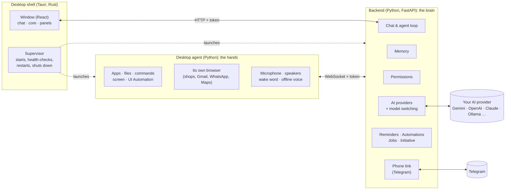

# JARVIS

**A personal AI assistant that lives on your Windows PC, modelled on JARVIS from the Iron Man films.**

It talks and listens, remembers you across conversations, and actually does things on your computer: opens apps,
runs commands, edits files, reads your screen and clicks for you, researches the web, reads your documents, plays
your music, finds places on Google Maps, runs jobs on a schedule, and answers you on your phone through Telegram.
You decide how much it may do, action by action.

**Bring your own AI.** JARVIS ships with no keys and no account. Use Google Gemini, OpenAI, Anthropic Claude,
OpenRouter, a local Ollama, or any OpenAI-compatible service. Your keys stay encrypted on your PC.

> **Status:** early and moving fast. Windows 10/11 only, run from source (no installer yet). Everything listed below
> works today; see [Roadmap](#roadmap) for what's next and [How you can help](#how-you-can-help) for what we'd love
> from you.

**Stack:** Tauri 2 (Rust) · React + TypeScript · Python 3.12 (FastAPI backend + desktop agent) · MIT licensed

---

## Contents

- [What JARVIS can do](#what-jarvis-can-do)
- [How it works](#how-it-works)
- [Safety, permissions and privacy](#safety-permissions-and-privacy)
- [AI providers and keys](#ai-providers-and-keys)
- [Getting started](#getting-started)
- [Using JARVIS](#using-jarvis)
- [Project layout](#project-layout)
- [Tests](#tests)
- [Roadmap](#roadmap)
- [How you can help](#how-you-can-help)
- [Acknowledgements](#acknowledgements) · [License](#license)

---

## What JARVIS can do

### Talk to it
- **Chat** in a floating window over an animated core that reacts to what JARVIS is doing (idle, listening,
  thinking, speaking).
- **Live voice** (speech-to-speech with Gemini Live): say "Jarvis, …", it answers in its own voice and can use all
  its tools while talking. Say "Hey JARVIS" while it speaks to cut in. Spoken captions follow the voice sentence by
  sentence.
- **Offline voice** when there's no Gemini key or the connection is too slow: openWakeWord for the wake word,
  NVIDIA Parakeet or Whisper for speech recognition, Piper for speech, all running on your PC.
- **Answers only you**, if you want: teach it your voice once and other people saying "Jarvis" are ignored
  (speaker verification, offline).
- **Your phone.** Pair your own Telegram bot and message JARVIS from anywhere; steps that need your OK arrive as
  Approve / Decline buttons.
- **Start-up briefing**: when it opens, JARVIS tells you how the PC is doing, what's running, and what's due today.
- **Initiative**: welcomes you back after you've been away, and follows up on a conversation left hanging (at
  most 3 times an hour, and only with a reason). Both can be turned off.

### Act on your PC
- **Apps and windows:** open, close, switch, arrange, wait for windows; find and press buttons by their real text
  (Windows UI Automation), falling back to Windows' built-in OCR when an app exposes nothing.
- **Screen:** look at the screen, read a window, click, drag, scroll and type anywhere.
- **Like a developer at a terminal:** run PowerShell or cmd (git, python, npm, winget…), read, write and edit
  files with automatic backups, list and end processes, start long jobs in the background.
- **Files:** find, open, copy, move, organise folders (with a dry-run plan first), delete to the Recycle Bin.
- **System:** health (CPU, memory, disk, battery, graphics card, temperatures), volume, media keys, brightness,
  lock, sleep, restart, Windows settings pages, start with Windows.
- **Reminders, alarms and timers**, spoken at the right time; ones missed while the PC was off are mentioned once.
- **Music:** "play Alfaaz on Spotify" searches Spotify, picks the right song and checks it's actually playing.

### Work with the web
- **Research with sources:** its own web search (no AI service involved), news headlines with dates, and the
  passages from each page that answer the question, quoted with their links.
- **A browser JARVIS drives** (its own Brave, Chrome or Edge window, with its own profile): shop and fill carts, order food, compare
  products. **Paying always stays with you**: pay/place-order buttons and password, card, OTP and UPI fields are
  refused in code.
- **Gmail and WhatsApp, read-only:** "anything important in my mail?", "what did Mom say on WhatsApp?". You sign
  in once in JARVIS's browser window; JARVIS never types passwords and never sends, deletes or replies there.
- **Google Maps:** places near you with ratings and reviews, directions and travel times, using your PC's real
  location (with your permission).
- **About 2,200 public APIs** (weather, crypto, sports, news, holidays…) from the public-apis list, most needing
  no key.
- **Downloads** it makes, and notices finished downloads you start yourself.

### Documents, on your PC
- Reads **PDF, Word, Excel, PowerPoint, text and images** (Windows OCR) and answers from the exact passages, with
  page, slide or sheet.
- Keeps files in its own **file store** so later questions about them are instant.
- **Creates** Word, Excel, PowerPoint and PDF files.
- **Sandboxed Python** for analysing data someone else made: no network, no programs, no files outside its own
  folder.
- None of the reading or making involves an AI service; only the answer does.

### Remembers you
- **Long-term memory:** durable facts about you (name, preferences, goals, projects, people, how you like
  answers) are picked out after each message, updated when they change, and forgotten when you ask. Small talk is
  ignored.
- **The Memory panel** shows everything it knows: edit, delete (the whole history of a fact goes with it), export
  and import.
- **Long conversations** are summarised as they go, so the beginning isn't forgotten.

### Learns and follows your way of doing things
- **Customize** is one place to shape JARVIS:
  - **Instructions**: how it should behave, in your own words ("keep it short", "reply in Hinglish", "my work
    folder is D:\Projects"). Read before every chat and voice conversation.
  - **Your skills**: named step-by-step recipes ("Morning setup: open Outlook and VS Code, play my focus
    playlist…"), used when you name them or your request matches.
  - **Learned workflows**: multi-step jobs that worked are remembered and reused as a guide next time; ones that
    keep failing are dropped.
  - **Automations**: jobs it does by itself on a schedule ("every weekday at 9, go through my unread mail and tell
    me what needs a reply"), with results spoken and/or sent to your phone. You can also just ask for one in chat.
  - **Phone**: link Telegram.
  - **Connectors**: any MCP server (Slack, Notion, GitHub, calendars, databases…) becomes JARVIS tools.
  - **API keys** for public APIs that need one.

### Handles long jobs well
- **Task mode:** a longer job shows its plan and progress; you can pause, take over the mouse and hand back, or
  stop at any step. A job cut short by a restart is offered once, never resumed on its own.
- **An advisor model** reviews long tasks every few steps and after failures.
- **Emergency stop** stops everything at once (also `/stop` from the phone).

### Gets the most out of any AI
- Prompt caching, token counting, tool search (only the relevant tools are sent each time), conversation
  compaction, and thinking/effort chosen per job, on Gemini, Claude and OpenAI-style providers alike.
- **Automatic model switching:** if a model is rate-limited, over quota or overloaded, JARVIS moves to another one
  and says so. It keeps its own count of each model's daily quota and learns the real limits.
- **A local AI gateway** (OmniRoute) can be started for you with one click, and used as a backup.

---

## How it works

JARVIS is four cooperating programs on your PC:



- **The shell** (`src-tauri/`) is the app you open. It starts the backend and agent hidden, checks they're healthy,
  restarts them if they crash, and closes everything cleanly when you quit.
- **The backend** (`backend/`) is the brain. It holds your settings (encrypted), memory, conversations, reminders,
  automations and permissions, talks to your chosen AI, and runs the agent loop: the AI proposes a tool call, the
  backend checks your permissions, asks you if needed, runs it, and hands back the real result. It only listens
  on `127.0.0.1` and every request needs a random token created at each start.
- **The agent** (`agent/`) is the hands. It does what the backend asks on Windows: apps, files, commands, screen,
  clicks and typing, its own browser, the microphone and speakers.
- **The window** (`src/`) is the React UI: chat, the animated core, and panels for conversations, memory,
  Customize, settings and system details.

### What happens when you ask for something

1. **You ask**, by typing, speaking, a Telegram message, or an automation firing.
2. **The backend gathers context:** the memories relevant to your message, your instructions, any of your skills
   or learned workflows that match, the time, the PC's state, recent files, and the tools that fit the request.
3. **The AI answers or calls a tool.** Each tool call goes through the **permission check** (allow, ask, or
   block), then runs. Results go back to the AI, with any saved key or token scrubbed out first.
4. **This repeats** until the job is done. Long jobs become a visible task you can pause or take over. Guards stop
   repeated identical steps and endless searching, and a watchdog stops a run that stalls.
5. **The reply** streams to the window (and is spoken, if you used your voice or the briefing is on). Afterwards,
   new facts about you are saved to memory and a successful multi-step job may become a learned workflow.

### Memory, in short

Each message is embedded and searched against what JARVIS knows; the best matches go into the prompt. After the
reply, a small model extracts durable facts as create, update or delete operations. Changed facts keep their
history (so changes are auditable) until they're purged, and deleting a fact removes all of it. Upkeep and
summaries run as background jobs while you're away from the PC. Providers without embeddings (Claude) use keyword
search instead.

### Voice, in short

- **Live mode:** the agent streams your microphone to the backend, which relays it to a Gemini Live session; the
  spoken reply streams back to your speakers, with captions in step with each sentence.
- **Offline mode:** wake word → speech recognition (Parakeet or Whisper) → the normal chat pipeline → Piper speech.
- If the connection is too slow for live voice, JARVIS switches to offline voice for a while on its own.

---

## Safety, permissions and privacy

JARVIS can do a lot on your PC, so control is built in, not bolted on.

**Permissions** (Settings → PC control & safety) set **Allow, Ask or Block** for each kind of action:

| Always asks first (can be blocked, never silently allowed) | Asks on a new install; "Full control" allows them |
|---|---|
| Installing or uninstalling software | Changing files · deleting to the Recycle Bin |
| System changes (registry, services, network, start-up) | Running commands |
| Restart, shut down, sleep | Ending processes · closing windows |
| Pressing Send, Pay, Buy, Post, Delete or Confirm in an app | Knowing the PC's location |
| Sending data to a website *after* reading something private | |
| Creating or deleting automations | |

Seeing the screen, reading Gmail/WhatsApp and downloading are allowed by default and can be set to Ask or Block.
Commands that would wreck Windows (formatting drives, boot config, wiping system folders) are always refused.

**Against prompt injection** (a web page, email or file trying to give JARVIS orders):
- Everything JARVIS reads from outside is marked as data, never instructions.
- Sending anything to a website, a connector, or through an upload command, in a request where JARVIS has already
  read private data (files, mail, messages, the screen, command output), always asks you first, even with Full
  control.
- No tool can open JARVIS's own key store or login token, change its data folder, or run commands that reach for
  them. Every saved key and token is scrubbed from tool results before the AI sees them.
- Paying stays with you, enforced in code.

**Your keys and data:**
- Settings and keys are encrypted with Windows DPAPI (only your Windows user on this PC can read them) and stored in
  `%LOCALAPPDATA%\JARVIS`. The window never receives a key, only its last four characters.
- A saved key goes only to the address it was entered for, only over https (or to this PC), and never along a
  redirect to another site. Changing a provider's address means typing the key again.
- Memory, conversations and files stay on your PC. What leaves it is what your chosen AI provider needs to answer,
  and the web requests you ask for.
- The sandbox for untrusted code has no network, can't start programs, and only touches its own folder.

Found a security problem? Please report it privately; see [SECURITY.md](SECURITY.md).

---

## AI providers and keys

| Provider | Key needed | Memory search | Tested |
|---|---|---|---|
| Google Gemini | Yes ([AI Studio](https://aistudio.google.com), free tier available) | Semantic (embeddings) | Live |
| OpenAI | Yes ([platform.openai.com](https://platform.openai.com/api-keys)) | Semantic | Protocol tests |
| Anthropic Claude | Yes ([console.anthropic.com](https://console.anthropic.com)) | Keyword (no embeddings API) | Protocol tests |
| OpenRouter (hundreds of models) | Yes ([openrouter.ai/keys](https://openrouter.ai/keys)) | Semantic or keyword | Protocol tests |
| Ollama (local, free) | No ([ollama.com](https://ollama.com)) | Semantic, e.g. `nomic-embed-text` | Protocol tests |
| Local AI gateway (OmniRoute, default `127.0.0.1:20128`) | Optional | Semantic or keyword | Live |
| Any OpenAI-compatible API (Groq, DeepSeek, Together, Mistral, LM Studio…) | Depends | Semantic or keyword | Protocol tests |

"Live" means verified end to end against the real service. "Protocol tests" means the request and response handling
is tested against a local server that speaks that provider's API. **Reports from real use are very welcome.**

| Feature | What it needs |
|---|---|
| Chat, memory, PC actions, screen reading, documents | A key for any provider above, or a local Ollama/gateway |
| Live speech-to-speech voice | A Google Gemini key. Without it, the offline voice is used |
| Web research, Google Maps, the public-APIs list | Nothing extra (some public APIs want their own key: Customize → API keys) |
| Offline voice, wake word, answering only you | Nothing: local models (see [Voice setup](#voice-setup)) |
| Phone | Your own free Telegram bot |

---

## Getting started

### Requirements
- Windows 10 or 11
- Python 3.12, Node 22, Rust (stable, MSVC) and the Visual Studio C++ Build Tools
- Brave, Chrome or Edge (for the browser window JARVIS drives: shopping, Gmail, WhatsApp, Maps)

### Install and run

```powershell
git clone https://github.com/Spidey007-Arch/jarvis.git
cd jarvis
powershell -ExecutionPolicy Bypass -File setup\install-deps.ps1
npm install
npx tauri dev
```

On first launch, JARVIS walks you through choosing an AI provider and pasting your key. You can change it any time
in **Settings → AI & models**.

### Voice setup

Voice runs entirely on your PC. Download these free files into `%LOCALAPPDATA%\JARVIS\voice\downloads`, then turn
on **Settings → Voice**:

| File | Source |
|---|---|
| `whisper-bin-x64.zip` | [whisper.cpp release b5130](https://github.com/ggml-org/whisper.cpp/releases/tag/b5130) |
| `ggml-base.en-q5_1.bin` | [whisper.cpp models](https://huggingface.co/ggerganov/whisper.cpp) |
| `piper_windows_amd64.zip` | [Piper 2023.11.14-2](https://github.com/rhasspy/piper/releases/tag/2023.11.14-2) |
| `en_GB-alan-medium.onnx` and `.onnx.json` | [Piper voices](https://huggingface.co/rhasspy/piper-voices/tree/main/en/en_GB/alan/medium) |
| `melspectrogram.onnx`, `embedding_model.onnx`, `hey_jarvis_v0.1.onnx` | [openWakeWord v0.5.1](https://github.com/dscripka/openWakeWord/releases/tag/v0.5.1) |
| `sherpa-onnx-nemo-parakeet_tdt_ctc_110m-en-36000-int8.tar.bz2` (optional, recommended) | [sherpa-onnx ASR models](https://github.com/k2-fsa/sherpa-onnx/releases/tag/asr-models): far more accurate than Whisper base. The larger `sherpa-onnx-nemo-parakeet-tdt-0.6b-v2-int8.tar.bz2` is used if present. |
| `wespeaker_en_voxceleb_resnet34_LM.onnx` (optional) | [sherpa-onnx speaker models](https://github.com/k2-fsa/sherpa-onnx/releases/tag/speaker-recongition-models): lets **Teach JARVIS my voice** make it answer only you |

Also install `pip install numpy onnxruntime sherpa-onnx` into the app's environment (`.venv`).

Say **"Jarvis"** with your request ("Jarvis, open Spotify"). Say "Hey JARVIS" while it talks to stop it.

### Phone setup

1. In Telegram, open **@BotFather**, send `/newbot`, and pick a name.
2. In JARVIS, open **Customize → Phone** and paste the token BotFather gives you.
3. Send your new bot the 6-digit code JARVIS shows. That chat, and only that chat, now talks to JARVIS.

In the chat, send any request; `/stop` stops what JARVIS is doing and `/new` starts a fresh conversation. No open
port or server is needed, but JARVIS must be running on your PC.

---

## Using JARVIS

Some things to try:

| You say | JARVIS |
|---|---|
| "How's the PC doing?" | Reports CPU, memory, disks, battery and what's using them |
| "Play Alfaaz on Spotify" | Searches Spotify, double-clicks the right song, checks it's playing |
| "Find cafés near me with good reviews" | Uses your location and Google Maps, lists ratings, reviews and opening hours |
| "What's the latest on the Weverse app?" | Searches the web and news, answers with quotes and links |
| "Summarise chapter 3 of the PDF on my desktop" | Reads it locally, answers with page numbers |
| "Make an Excel sheet of my expenses from this CSV" | Analyses in the sandbox, creates the workbook |
| "Clean up my Downloads folder" | Shows a plan first, then moves files into folders |
| "Every weekday at 9, check my mail and send me what matters" | Creates an automation (asks you first), sends results to your phone |
| "Remind me to call Papa at 7" | Speaks the reminder at 7 |
| "Run the tests in D:\Projects\app and fix what fails" | Runs commands, reads and edits files (with backups), reports the real output |

The **panels** on the left rail: Conversations, Memory, Customize, Settings, System. The model picker and today's
AI quota are in the top bar.

---

## Project layout

```
src-tauri/   Rust shell: window, supervisor that launches and watches the backend and agent
src/         React UI: core, chat, panels (Memory, Customize, Settings, System, tasks)
backend/     FastAPI brain
  jarvis_backend/
    api.py           chat, agent loop, tools, permissions in action, all HTTP endpoints
    llm.py           AI providers, model switching, quotas;  providers/ for each API
    memory.py        long-term memory; extraction.py the fact extractor
    persona.py       JARVIS's character and the system prompt
    permissions.py   Allow / Ask / Block per capability, prompt-injection guards
    tools.py         every tool JARVIS can call; toolsearch.py picks the relevant ones
    automations.py   scheduled jobs;  phone.py the Telegram link
    reminders.py     reminders, alarms, timers;  jobs.py idle-time housekeeping
    research.py      web search and page reading;  public_apis.py the public-APIs list
    live.py          Gemini Live voice;  briefing.py, initiative.py, monitor.py, tasks.py, skills.py
    connectors.py    MCP client;  gateway.py the local AI gateway;  settings.py encrypted settings
agent/       The hands on Windows
  jarvis_agent/
    actions.py       apps, files, commands, processes, system
    uictl.py         UI Automation, OCR, windows, Spotify
    webdrive.py      JARVIS's own browser;  mailchat.py Gmail/WhatsApp (read-only);  maps.py Google Maps
    docs.py          reading and creating documents;  sandbox.py isolated Python
    voice.py, wakeword.py, asr.py, speech.py, speaker.py, live_audio.py   voice
common/      Shared Python: paths, logging, Windows DPAPI encryption
setup/       Dependency installer
```

---

## Tests

```powershell
cd backend;  ..\.venv\Scripts\python.exe -m unittest discover -s tests -p "test_*.py"
cd ..\agent; ..\.venv\Scripts\python.exe -m unittest discover -s tests -p "test_*.py"
cd ..;       npx tsc --noEmit
```

About 200 tests cover the backend (memory, providers, permissions, switching, research, reminders, automations,
phone pairing, key safety…) and the agent (commands, files, sandbox, documents, voice, browser).

---

## Roadmap

### Done
- Startup and reliability: supervised processes, health checks, clean shutdown
- Memory and multi-provider chat, with automatic model switching
- Desktop automation: apps, files, commands, screen, UI Automation, browser, shopping (you pay), Gmail/WhatsApp
  (read-only), Spotify, Google Maps, documents, sandbox
- Persona, situational awareness, proactive alerts, start-up briefing, initiative
- Voice: live speech-to-speech, offline voice, wake word, answering only you, synced captions
- Permissions with prompt-injection guards and key protection
- Customize: instructions, your skills, learned workflows, connectors, API keys
- Automations and phone control (Telegram)

### Next
| Item | What it means |
|---|---|
| **Installer** | A normal Windows installer and a portable build, no Python/Node/Rust needed |
| **Auto-update** | Signed updates from GitHub releases |
| **Undo and checkpoints** | Roll back what a task changed (files, settings) in one click |
| **Rich outputs** | Charts, tables and documents shown in a side panel, not just text |
| **Parallel tasks** | Several jobs at once, each in its own lane you can watch |
| **Skill sharing** | Import and export skills as files (the open SKILL.md format), and share them with others |
| **Voice notes from the phone** | Send a voice message on Telegram and get a spoken reply |

### Ideas we're considering
- More channels: WhatsApp (official API), Discord, Slack, email
- Calendar: read, plan and add events (Google/Outlook)
- Smart home through Home Assistant
- A heartbeat: JARVIS checks a short list of things you care about every so often, and speaks up only when needed
- Hooks: run your own scripts before or after JARVIS does something
- A plugin system and a place to find community skills and connectors
- More languages for the interface and the voice (Hindi first)
- macOS and Linux versions
- Encrypted backup and sync of memory and settings between your PCs
- A mobile companion app

**Have an opinion on what comes first, or an idea that isn't here?** That's exactly what we want to hear: see below.

---

## How you can help

JARVIS gets better with real people using it on real PCs. Any of these helps a lot:

- **💡 Suggest a feature or change.** [Open a feature request](https://github.com/Spidey007-Arch/jarvis/issues/new?template=feature_request.yml):
  what you'd like JARVIS to do, and the situation where you'd use it.
- **🐛 Report a bug.** [Open a bug report](https://github.com/Spidey007-Arch/jarvis/issues/new?template=bug_report.yml)
  with what you asked, what happened, and the log lines from `%LOCALAPPDATA%\JARVIS\logs` (remove anything
  private first).
- **🧪 Test a provider.** Only Gemini and the local gateway are verified live. If you use OpenAI, Claude,
  OpenRouter, Ollama, Groq, DeepSeek or another, [tell us how it went](https://github.com/Spidey007-Arch/jarvis/issues/new?template=provider_report.yml).
- **📱 Try the phone link** and tell us how pairing, replies and the Approve buttons work for you.
- **🗣️ Voice in your language:** wake words, speech models and voices for languages other than English.
- **🎨 Design:** ideas or mock-ups for the interface.
- **🔧 Code:** pick an issue labelled `good first issue` or `help wanted`, or anything on the roadmap. Read
  [CONTRIBUTING.md](CONTRIBUTING.md) first.
- **💬 Questions and rough ideas** that aren't a feature request yet: [open a question](https://github.com/Spidey007-Arch/jarvis/issues/new?template=question.yml).

**Specific questions we'd love answers to:**
1. Which should come first: the installer, undo/checkpoints, or parallel tasks?
2. Which messaging app do you want besides Telegram?
3. Which apps would you most like JARVIS to work with (calendar, Notion, Discord, your IDE…)?
4. How much should JARVIS do on its own without asking? Is the current permission model too cautious, or not
   cautious enough?
5. What would make you trust an assistant with this much access to your PC?

---

## Acknowledgements

- [public-apis](https://github.com/public-apis/public-apis) for the API catalogue (MIT, see
  `backend/jarvis_backend/data/public_apis.LICENSE`)
- [openWakeWord](https://github.com/dscripka/openWakeWord), [Piper](https://github.com/rhasspy/piper),
  [whisper.cpp](https://github.com/ggml-org/whisper.cpp), [sherpa-onnx](https://github.com/k2-fsa/sherpa-onnx) and
  NVIDIA Parakeet for the offline voice
- [Tauri](https://tauri.app), [FastAPI](https://fastapi.tiangolo.com) and [React](https://react.dev)
- [OmniRoute](https://github.com/diegosouzapw/OmniRoute) for the local AI gateway
- The Model Context Protocol for connectors

JARVIS is a fan project and is not affiliated with Marvel or Disney.

## License

[MIT](LICENSE)
